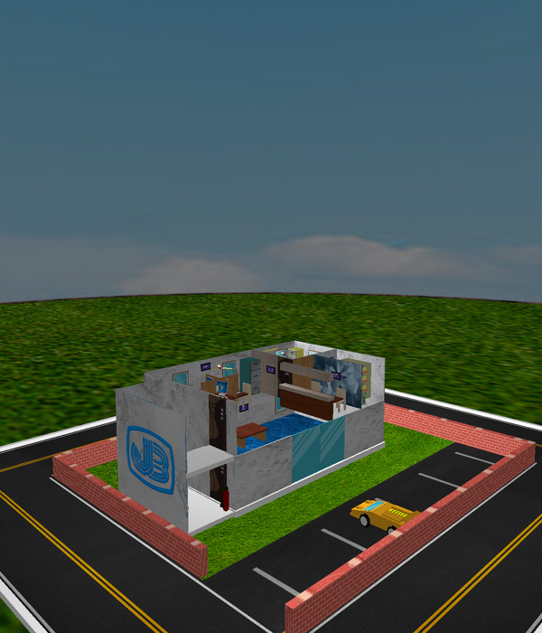
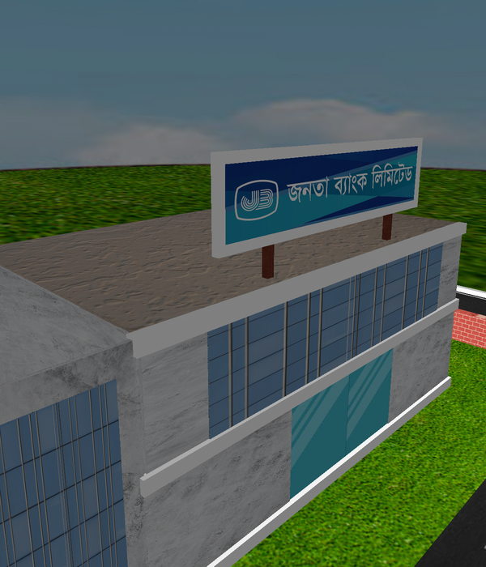
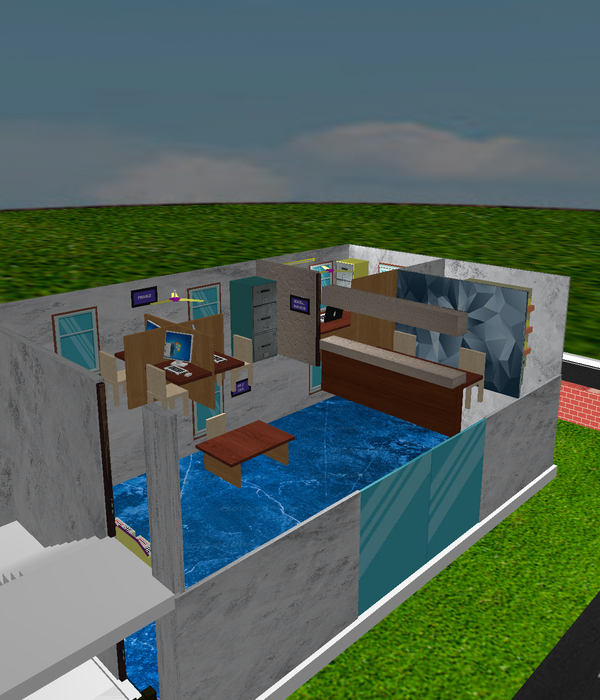
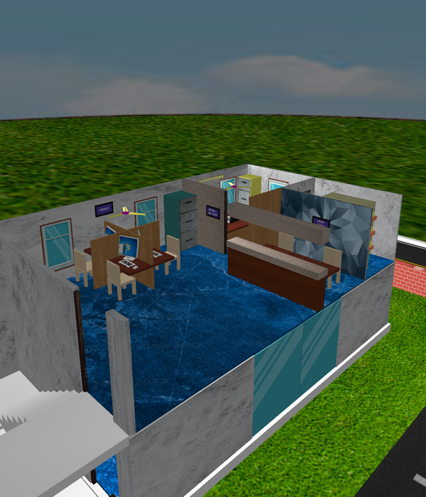
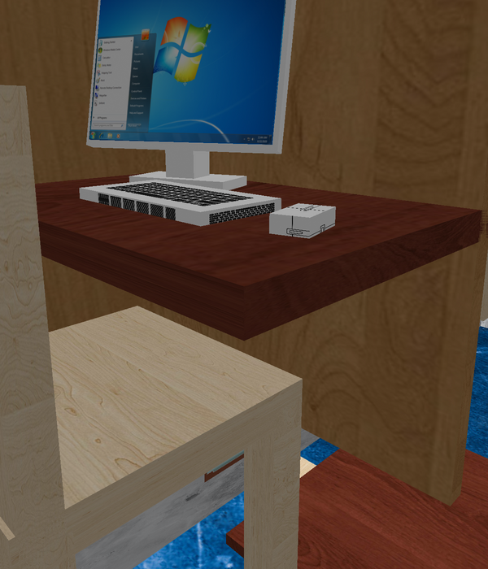
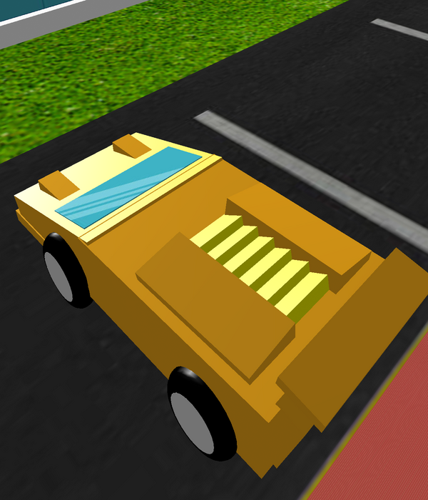
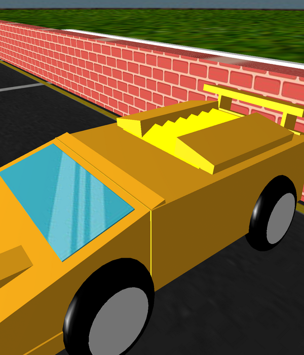

# Janata-Bank-project

A 3D model of a Janata Bank branch built with OpenGL and GLUT in C++. The scene includes a two-floor bank interior (cubicles, cashier counter, vault, GM room, ATM), an exterior with a rooftop sign, a road and parking lot, and a drivable car.

## Screenshots

| Overview | Exterior |
|:---:|:---:|
|  |  |

| Ground floor cutaway | Second floor |
|:---:|:---:|
|  |  |

| Main doors open | Cubicle close-up |
|:---:|:---:|
|  |  |

| Yellow car | Yellow car (side) |
|:---:|:---:|
|  |  |

## Controls

| Key | Action |
|---|---|
| `W` / `S` / `A` / `D` | Move camera up / down / left / right |
| `+` / `-` | Move camera forward / backward |
| `*` / `/` | Zoom in / out |
| `I` `J` / `O` `P` / `K` `L` | Roll / yaw / pitch |
| `T` / `R` | Rotate scene around Y / X axis |
| `X` | Toggle exterior (closed building) view |
| `Z` | Toggle second floor |
| `M` | Open / close main doors |
| `V` / `B` / `N` | Open / close GM, 1st floor, 2nd floor doors |
| `1` / `2` | Toggle sun / rotate sun |
| `3` / `4` / `5` / `Q` | Toggle GM / 2nd floor / 1st floor / spot lights |
| `6` | Toggle ceiling fan |
| `C` | Toggle axis |
| Arrow keys | Drive the car |
| `Esc` | Quit |

## Building

Open `ogl/ogl.cbp` in Code::Blocks (Windows, with GLUT). Texture paths in `main.cpp` point to `C:\Users\Raiyan\Desktop\ogl\`, so update them to your own folder before running.
